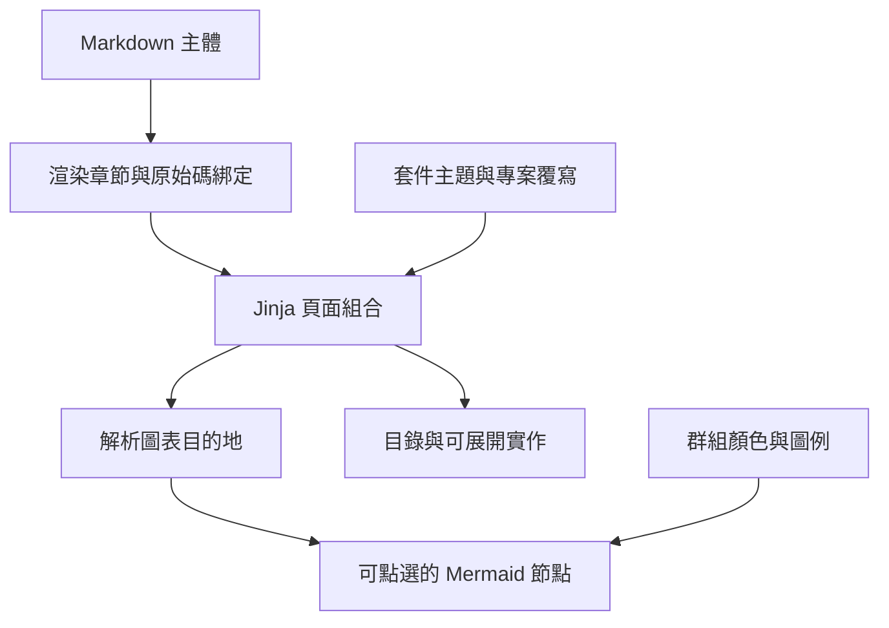

## 從模型到頁面 {#inside-the-renderer}


Figure: 從共用模型到發佈頁面。每個節點開啟實作該階段的章節。

專案宣告[語意群組](#groups)後，節點顏色代表所連結頁面的群組：填色節點開啟元件，無填色節點開啟章節。未設定群組時，藍色連結節點開啟元件，綠色連結節點開啟章節。同一頁可作為靜態 HTML 使用；JavaScript 增強圖表與閱讀工具。

## Markdown 轉為章節 {#markdown}

`render_body()` 將 Mermaid 區塊與一般 Markdown 分開。Markdown 轉成 HTML；圖表保持為已跳脫的原始內容，直到瀏覽器使用隨附 Mermaid 函式庫渲染。每個章節依 Markdown 順序只輸出一次。標題 ID 成為穩定目的地，帶標籤的宣告直接顯示在說明下方。

緊接在 Mermaid 區塊之後、以 `Figure:` 開頭的段落會成為該圖表的說明文字。有說明的圖表依頁面順序跨章節編號（`圖 1`、`圖 2`）；沒有說明的圖表不列入編號。GitHub 提示區塊（第一行為 `> [!NOTE]`、`TIP`、`IMPORTANT`、`WARNING` 或 `CAUTION`）會成為加上標籤的提示框；其他引用區塊維持不變。翻譯頁面顯示在地化的圖表與提示標籤。索引與 CLI 保留原始 Markdown。

## 組合與發佈頁面 {#publication}

`render_site()` 優先從專案的 `wiki/_theme/` 載入 Jinja 範本，再回退到套件預設值。`_base.html.j2` 負責共用導覽與外框；`page.html.j2` 負責章節、相依關係、元件卡片、圖表與原始碼面板。`index.html.j2` 與 `files.html.j2` 提供總覽及檔案查找。

沒有父頁的頁面在側邊欄與總覽卡片中是獨立根頁。兩處都將手冊根頁排在其他根頁之前，各群組內維持原順序。側邊欄以連到 `index.html` 的總覽連結開始；瀏覽總覽時會標示目前位置，且該連結也參與頁名搜尋。`type: manual` 的根頁使用真實頁面階層顯示閱讀路徑，因此手冊與後代不顯示架構閱讀步驟；架構頁仍使用「架構 → 元件 → 實作」路徑。

CSS 提供響應式配置、圖表畫布與閱讀深度提示。沒有客戶端應用程式路由器或正式環境應用伺服器。輸出包含本地 Mermaid 與語法醒目提示資產，可由任何靜態主機提供。

預設總覽也列出待處理文件審查。各頁將審查狀態及上次理由與作者的 `status`（例如 stable 或 draft）分開呈現。這些是建置時的結果；即時審查 API 讀取目前檔案。自訂主題必須明確加入這些面板。

## 解析圖表連結 {#navigation}

`diagram_targets()` 依下列優先規則解析節點名稱：

1. 符合文件 ID 的節點連到該元件頁。
2. 符合本頁標題 slug 的節點連到該章節。
3. 明確的 `diagram_links` 項目覆寫自動比對。

例如上圖的 `navigation` 節點指向這裡。作者也可將簡短節點名稱對應到 `documents.validation`，連到另一頁的章節。建置會驗證明確目的地，不會根據節點位置或原始碼標籤推論執行時相依；這些關係由作者宣告。

## 語意群組 {#groups}

圖表、元件卡片與頁面標題中的顏色只代表一件事：元件所屬的群組。`wiki.config.yaml` 宣告群組：

```yaml
groups:
  firmware:
    color: blue
    label: {en: CM33 firmware, ch_tw: CM33 韌體}
  shared:
    color: violet
    label: Shared RAM
```

`validate_groups()` 只接受主題調色盤名稱 `blue`、`green`、`violet`、`amber`、`red`、`teal`、`pink` 與 `slate`。每個名稱在 `style.css` 中都有淺色與深色數值，因此專案選擇的是意義而不是色碼。標籤可以是文字，或從 HTML 語言對應到文字的對照表，並以英文作為回退。語言鍵使用翻譯檔後綴的拼法（`en`、`ch_tw`；`zh_tw` 為別名）。

頁面在 frontmatter 宣告 `group: firmware`。`resolve_groups()` 讓沒有自身群組的頁面採用最近祖先頁的群組，因此子元件沿用其子系統的顏色。未知群組名稱是嚴格建置錯誤。索引記錄每頁解析後的 `group`，`query doc` 也會顯示。

`diagram_styles()` 讓每個圖表節點採用其連結頁面或章節的群組。frontmatter 的 `diagram_groups` 可明確指定任何節點的群組，包括未連結的節點，以及連到未分組頁面的節點。接著瀏覽器中的 `diagrams.js` 會：

- 以群組顏色為已分組節點填色，並為章節連結描邊；
- 依來源節點為每條流程圖連線（包括箭頭）上色；
- 只有當子圖內所有節點屬於同一群組時，才為該子圖填色；
- 加入圖例，列出該圖表中出現的群組。

頁面標題與元件卡片使用相同的群組顏色，因此元件無論出現在哪裡都保持同一顏色。沒有群組的頁面與節點維持預設主題顏色。

> [!TIP]
> 在每個子系統頁面設定 `group`，讓其元件沿用；`diagram_groups` 只用於沒有專屬頁面的節點。

## 圖表節點的程式碼標籤 {#code-labels}

有連結的流程圖節點會多出一行等寬字型文字，標示其背後的程式碼。`code_label()` 從建置已掌握的證據取得文字：

- 章節目標顯示第一個帶標籤的宣告，例如 `build.py · run()`；若該處標記了更多宣告，則加上 `+N`；
- 頁面目標顯示第一個負責說明的檔案，例如 `config.py +2`；
- 沒有標籤或負責檔案的目標不加第二行。

`annotate_mermaid()` 在渲染每一頁時加入這一行，因此索引與 `query section` 保留作者撰寫的 Mermaid。它只修改以標籤宣告的流程圖節點（`id["Label"]`、`id(Label)` 及其他括號形狀）。單純的節點 ID、Markdown 字串標籤，以及已含 `<br>` 的標籤維持不變，因此作者自行撰寫的第二行優先。由於文字來自原始碼標籤，宣告移動時只要標籤隨之移動，文字也會跟著更新。在 `wiki.config.yaml` 設定 `diagram_code_labels: false` 即可關閉。

## SVG 圖 {#figures}

Mermaid 無法繪製時序圖、記憶體配置或需要精確擺放的泳道。這類圖請將手繪 SVG 檔放在 Markdown 旁，並以獨立一行的圖片語法引用：

```markdown

Figure: 建置會更新索引，但永遠不會確認審查。
```

渲染器會將檔案內嵌，而不是以圖片連結，因此圖會跟隨頁面主題、深色模式與群組顏色。`Figure:` 說明文字的用法與 Mermaid 相同，兩種圖共用頁面的圖號。路徑相對於 Markdown 檔，且必須位於 Wiki 實例內；翻譯頁可指向自己的在地化 SVG。遠端與絕對路徑的圖片維持一般圖片。

`inline_figure()` 為頁面準備每個檔案：

- **ID：** 每個 `id` 及其 `url(#…)`、`href="#…"` 與 `aria-labelledby` 參照都加上每張圖專屬的前綴，因此同頁的兩張圖不會衝突。
- **群組：** 帶有 `data-group="cm33"` 的元素會取得該群組的顏色類別，下列圖形類別便以群組顏色繪製。
- **連結：** `<a data-link="build.orchestration">` 會取得該頁面或章節的 `href`，解析方式與 `diagram_links` 相同，翻譯頁則使用在地化連結。

| 類別 | 繪製內容 |
| --- | --- |
| `fig-text`、`fig-muted`、`fig-code`、`fig-title` | 內文、次要、程式碼與粗體文字 |
| `fig-label`、`fig-accent` | 群組顏色的文字（泳道標題、重點） |
| `fig-box` | 頁面背景、群組顏色邊框的方塊 |
| `fig-tint` | 以群組淺色填滿的方塊 |
| `fig-lane` | 無邊框的淺色背景帶 |
| `fig-line`、`fig-wave`、`fig-dash` | 連接線、訊號波形、虛線修飾 |
| `fig-head` | `<marker>` 內的箭頭路徑 |
| `fig-grid`、`fig-halo` | 點狀輔助線；在線條上仍清楚可讀的文字外框 |

`figure_issues()` 會讓嚴格建置在下列情況失敗：檔案不存在、路徑位於實例外、含有 script、嵌入內容或事件處理屬性、使用未宣告的群組，或連結目標未知。頁面的圖會納入其審查範圍，因此編輯 SVG 會讓該頁需要審查；SVG 檔也計入索引新鮮度。`query doc` 會在 `Figures:` 下列出它們。`wiki-author` 技能在 `references/figures.md` 中提供相同的類別說明，供繪製圖的代理使用。

## 瀏覽器行為 {#diagrams}

`diagrams.js` 渲染每個圖表，並將符合的節點包入真正的 SVG 連結。連結支援鍵盤焦點、一般導覽、複製目的地與另開分頁。展開按鈕放大畫布；Escape 關閉。每個具有明確對應的圖表下方，都有一般目的地清單；圖表無法渲染或讀者偏好文字時，可沿相同路徑閱讀。

每個具有有效 viewBox 的 SVG 都會取得獨立的裁切視窗。縮放按鈕與以指標為中心的滾輪縮放會調整 viewBox，範圍為初始完整視野的 25–800%；符合視窗可恢復初始視野。拖曳可平移圖表，也支援觸控螢幕單指操作。移動超過小幅門檻後才擷取指標，並阻止拖曳產生的點擊，避免拖曳連結節點時跳頁。畫布取得焦點後支援 +/− 縮放、方向鍵平移及 0/Home 恢復完整視野。工具列標籤與操作提示跟隨 HTML 語言。相同視窗移入或移出對話框時保留狀態，CSS 配合可用空間調整顯示且不拉伸圖表。

## 閱讀與原始碼證據 {#reading}

側邊欄以巢狀原生 `details` 群組呈現父頁，摘要內保留獨立頁面連結。目前頁面與祖先預設展開，其餘群組預設收合。個別群組不需要 JavaScript。渲染器也保留供自訂主題使用的平面 `nav` 資料契約。

`render_site()` 提供含 `id`、`title`、`out`、`depth` 與 `children` 的 `nav_tree` 節點；`_base.html.j2` 遞迴渲染。總覽與原始碼索引沒有目前文件分支，因此群組預設關閉。展開狀態只屬於目前頁面；導覽或重新載入時使用下一頁產生的預設值，不儲存展開偏好。

`reading.js` 加入全部展開／收合控制及文件樹篩選，顯示符合項目的祖先，清除搜尋時恢復搜尋前狀態。搜尋會去除首尾空白、不分大小寫，且要求每個以空白分隔的詞都出現在頁面標題。父頁標題符合不會自動顯示不符合的子頁。搜尋期間停用全部群組控制。初次載入寬度不超過 760 像素時，腳本會收合外層「瀏覽文件」面板；讀者可開啟它以存取同一棵樹。

腳本追蹤目錄中可見章節，並在程式碼可見時載入語法醒目提示。原生 `details` 將實作主體保持關閉，直到讀者要求展開；檔案路徑與行範圍標明原始碼證據。檔案責任連結使用設定的編輯器開啟，也適用於未作為標籤語言剖析的 Jinja、CSS、JavaScript 與 Markdown 資產。

HTML 包含不超過設定行數的宣告片段。需要新鮮度檢查的分頁原始碼擷取請用 `query source`。Markdown 與 Mermaid 是受信任的專案內容，因此內嵌 HTML 由專案作者控制。

## HTML 翻譯 {#translations}

在英文頁旁新增 `renderer-ch_tw.md` 之類的同層檔案。區域後綴 `-ll_rr.md` 選擇 HTML 語言；`ch_tw` 與 `zh_tw` 都表示台灣繁體中文，輸出後綴為 `-ch_tw.html`，HTML 語言為 `zh-TW`。其他區域後綴（例如 `ja_jp`）產生額外語言選項；沒有介面翻譯目錄時，介面文字回退為英文。

翻譯保留英文 frontmatter 的 `id`，以及所有標題的層級、順序與錨點。翻譯標題請明確指定 `{#english-slug}`，包含英文中原本隱含的標題。可翻譯 `title`、`summary`、正文及選用的決策理由。關係、檔案責任、參照、原始碼片段與審查狀態繼承自英文。無效同層檔案、ID／標題不符與重複語言別名，都會使嚴格發佈失敗。

渲染器輸出各語言的總覽、檔案索引與文件頁。語言連結可離線使用，不需要 JavaScript。頁面導覽、相依關係、圖表連結，以及一般標準 `.html` 或相對 `.md` 連結，都維持所選語言。尚未翻譯的頁面會顯示英文內容與明確備援提示。切換語言會開啟對應頁面，明確章節錨點保持穩定。

只有英文進入分析、審查與 CLI 文件索引，因此技能繼續閱讀英文。翻譯檔案仍參與建置新鮮度與預覽。移除翻譯後，`rendered_pages` 清單用於清理過期語言頁。自訂範本可使用 `locale`、`html_lang`、`page_url`、`tr` 與 `language_options`；覆寫預設外框時，必須自行加入語言切換器。
